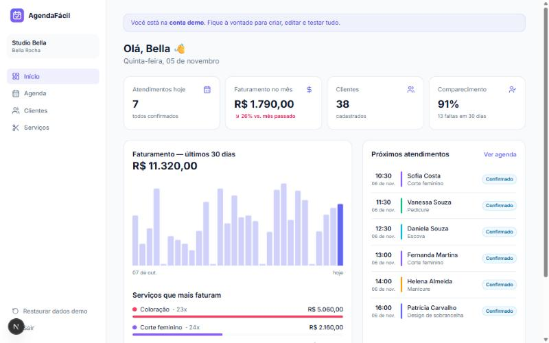

# AgendaFácil

SaaS de agendamentos para pequenos negócios (salões, barbearias, clínicas e estúdios): agenda, clientes, serviços e faturamento num painel só, com contas separadas por negócio.

**🔗 Demo:** [agendafacil-beta-murex.vercel.app](https://agendafacil-beta-murex.vercel.app). Para testar, clique em **"Testar com conta demo"**.



## Funcionalidades

- **Contas e login**: cadastro de negócio, senha com hash bcrypt e sessão em JWT num cookie `httpOnly`; o middleware protege as rotas `/app`
- **Multi-tenant**: todo dado pertence a um `business_id`, e toda query e Server Action filtra pelo negócio da sessão
- **Dashboard**: atendimentos do dia, faturamento do mês comparado com o mesmo período do mês anterior, comparecimento, gráfico dos últimos 30 dias e serviços que mais faturam
- **Agenda**: navegação por semana, indicador de dias com horários, criação de agendamento e fluxo de status (agendado → confirmado → concluído / faltou / cancelado)
- **Clientes**: busca por nome ou telefone, nº de visitas, total gasto, última e próxima visita (agregações em SQL)
- **Serviços**: duração, preço e cor na agenda; ativar e desativar com atualização otimista
- **Conta demo** com cerca de 60 dias de histórico gerado e botão para restaurar os dados
- Responsivo: menu lateral no desktop e navegação inferior no celular

## Tecnologias

- **Next.js 15** (App Router, Server Components e Server Actions) · **React 19** · **TypeScript**
- **PostgreSQL** com **Drizzle ORM**
- **Tailwind CSS 4** · **zod** (validação) · **jose** (JWT) · **bcryptjs**

### Banco de dados sem configuração

- **Sem `DATABASE_URL`**: o app usa o [PGlite](https://pglite.dev), um PostgreSQL completo rodando dentro do Node e salvo em `.data/`. Basta `npm run dev`.
- **Com `DATABASE_URL`**: conecta num Postgres de verdade (Neon, Supabase, RDS…).

O mesmo schema e o mesmo SQL valem nos dois casos. As tabelas são criadas automaticamente, e a conta demo é populada na primeira execução.

## Rodando localmente

```bash
npm install
npm run dev
```

Acesse http://localhost:3000 e entre com a conta demo.

## Deploy (Vercel + Neon)

1. Crie um banco gratuito no [Neon](https://neon.tech) e copie a connection string
2. Importe o repositório na [Vercel](https://vercel.com)
3. Configure as variáveis `DATABASE_URL` e `AUTH_SECRET` (veja o `.env.example`)

## Estrutura

```
src/
  app/
    actions.ts            # Server Actions (auth, agenda, clientes, serviços)
    (auth)/               # login e cadastro
    app/                  # painel: dashboard, agenda, clientes, serviços
  db/
    schema.ts             # tabelas (Drizzle) + DDL
    index.ts              # conexão PGlite / PostgreSQL
    seed.ts               # conta demo e dados de exemplo
  lib/
    queries.ts            # consultas e agregações
    dates.ts              # datas no fuso America/Sao_Paulo
    session.ts, auth.ts   # JWT e proteção de rotas
  middleware.ts
```

## Próximos passos

- Página pública de agendamento para o cliente final
- Lembretes automáticos por WhatsApp
- Vários profissionais por negócio
